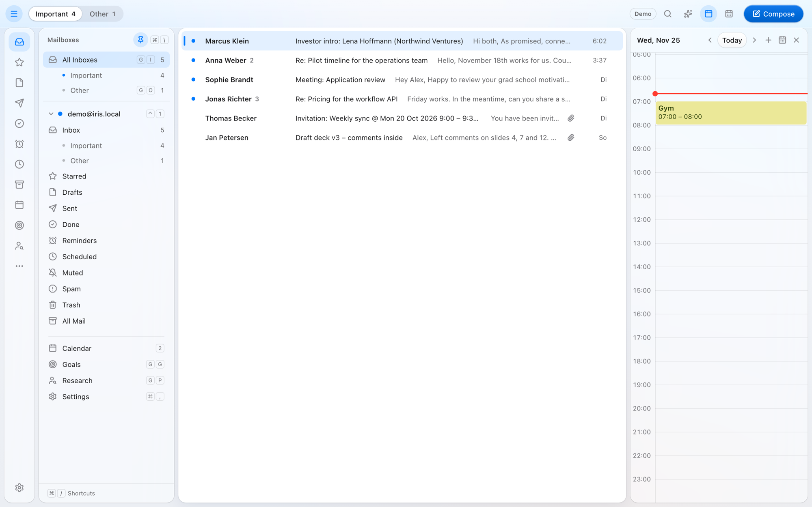

# Iris

A keyboard-first Gmail client for macOS, with a CLI and an MCP server so your AI agents can use the same mail and calendar features you do.

Everything runs locally on your Mac. Iris talks directly to the Gmail and Google Calendar APIs with your own Google OAuth client, and to the Claude API with your own key. There is no Iris server, no account, no tracking.

> Status: early, built for daily personal use. Expect rough edges. macOS only for now.



## Features

- **Split inbox**: Important / Other plus your own splits (saved Gmail queries). `Tab` switches.
- **Keyboard everything**: `e` done, `h` remind, `j/k` move, `r/a/f` reply / reply all / forward, `#` trash, `l` label, `v` move, `g i` go to inbox, `⌘K` command palette, `⌘/` all shortcuts.
- **Remind me**: natural language ("fri 3pm", "in 3 days"), optionally only if nobody replies.
- **Undo send, send later, send + done**: `⌘↵`, `⌘⇧L`, `⌘⇧↵`. `Z` undoes the last action.
- **Snippets** with variables: type `;` in the composer or press `⌘;`.
- **Instant search**: local SQLite FTS index plus Gmail search, Gmail query syntax.
- **Calendar**: day pane, week view, create events from plain text, RSVP from invites, share availability.
- **Contacts sidebar**, autocomplete, one-click unsubscribe (RFC 8058), block sender, mute.
- **Tracking pixel blocking**: 1×1 images and known open trackers never load.
- **Multiple accounts** with a unified "All Inboxes" view.
- **Themes**: Glass (light, default), Graphite (dark), Paper. `⌃T` toggles.
- **AI (Claude)**: summarize (`i`), write with AI (`⌘J`), instant reply, ask your mailbox (`?`), translate (`⇧T`).
- **Person research** (optional): before a meeting, Claude researches who you are meeting (web search plus what your mail and calendar already know) and writes a short brief.
- **Goals**: step goals, numeric goals (e.g. 80 → 75 kg) and daily habits, with progress against time and linked threads (`g g`, `⇧G`).
- **CLI + MCP server**: every core action is scriptable and available to agents like Claude Code or Codex.

Not included on purpose: read receipts (they need a public tracking server), team comments, Outlook.

## Architecture

```
Iris.app / browser ─┐
iris CLI ───────────┼── HTTP (127.0.0.1, token) ──► daemon ──► Gmail + Calendar REST APIs
MCP server (stdio) ─┘                                 │
                                                      ├── SQLite + FTS5 (cache, reminders, outbox, snippets, goals)
                                                      └── Claude API (only when you use an AI feature)
```

- `packages/core`: sync (initial + incremental `history`), store, query language, actions with undo, reminders, outbox, calendar, AI
- `packages/server`: local daemon, REST + SSE, serves the UI
- `packages/web`: React UI
- `packages/cli`: the `iris` command
- `packages/mcp`: MCP server for agents

## Privacy

- Data lives in `~/Library/Application Support/Iris/`. OAuth tokens and API keys are stored in the macOS Keychain (service "Iris Mail").
- Mail only travels between your Mac and Google.
- Mail content goes to the Claude API only when you use an AI feature (summarize, write, ask, translate, research).
- **Auto labels** (off by default) send subject, sender and the first 1,500 characters of new mail to an OpenRouter model (configurable in Settings → AI, providers without data retention only).
- **Person research** sends the person's name and email, your context note, meeting details and excerpts from up to 8 threads with that person to the Claude API (with web search).

## Setup

Requirements: macOS, Node 24+, Google Chrome (used for the app window).

### 1. Install

```bash
git clone https://github.com/cyncedin/iris.git
cd iris
npm install
npm run install:mac     # builds the UI, links `iris` into ~/.local/bin, creates ~/Applications/Iris.app
```

Make sure `~/.local/bin` is on your `PATH`. Optional: `bash scripts/install-mac.sh --login` starts the daemon at login.

### 2. Try the demo (no Google account needed)

```bash
iris start --demo && iris open --demo    # fictional mailbox on port 7788
```

### 3. Create your own Google OAuth client

Iris has no shared Google app. You create a free OAuth client in your own Google Cloud project, so your mail never touches anyone else's credentials.

1. Open the [Google Cloud Console](https://console.cloud.google.com/) and create a project.
2. Enable the [Gmail API](https://console.cloud.google.com/apis/library/gmail.googleapis.com) and the [Google Calendar API](https://console.cloud.google.com/apis/library/calendar-json.googleapis.com).
3. Configure the OAuth consent screen (type "External" is fine) and add yourself as a user.
4. Set the publishing status to **In production**. In "Testing" mode Google expires refresh tokens after 7 days. You will see an "unverified app" warning at login. That is expected for a personal client.
5. Create credentials → OAuth client ID → **Desktop app**, and download the JSON.

### 4. Connect

```bash
iris auth client ~/Downloads/client_secret_….json   # stores the OAuth client in the Keychain
iris auth login                                     # browser consent, then the initial sync starts
iris ai key                                         # your Anthropic API key (hidden input, stored in the Keychain)
iris open                                           # or Spotlight → "Iris"
```

AI features are optional. Without a key, everything else works.

### Sync behaviour

Gmail allows about 6,000 quota units per minute per user, and full thread fetches are expensive. Iris therefore syncs metadata first (headers, snippet, labels; about 1,500 threads in a few minutes), preloads bodies of the newest 30 inbox threads, and loads everything else when you open it (about 0.5 s). New mail arrives complete. Whatever you trigger takes priority over background sync, and an interrupted initial sync resumes from its checkpoint.

## CLI

All commands: `iris help`. Add `--json` for machine-readable output.

```bash
iris inbox --split Important --unread
iris search "from:anna has:attachment newer_than:7d"
iris read <threadId>
iris done <threadId…>                                   # like `e`
iris remind <threadId> --when "monday 9am" --if-no-reply
iris reply <threadId> --body "Sounds good, see you Friday."    # saves a draft
iris reply <threadId> --body "…" --send                         # asks for confirmation in the terminal
iris summarize <threadId>
iris ask "When is my flight to Lisbon?"
iris translate <threadId> --to English
iris classify propose && iris classify accept           # Claude drafts the label set
iris goals add "Launch v1" --due "in 6 weeks" --steps "Script,Video,Rehearsal"
iris goals add "Weight" --due 2026-12-31 --kind metric --start 80 --target 75 --unit kg
iris goals log <goalId> 78.4 [--date YYYY-MM-DD]        # one value per day, new replaces old
iris goals log <goalId> --done [--date YYYY-MM-DD]      # habit
iris research "Elena" --context "investor, Berlin, fintech?"
iris research list | iris research show <id> | iris research rm <id>
iris undo
```

## Goal kinds

| Kind | Progress | Entry |
|---|---|---|
| `steps` (default) | completed steps / all steps | check off steps |
| `metric` | (start − current) / (start − target), clamped to 0–100 %, works for rising targets too. Expected value runs linearly from start to due date | one value per calendar day, new replaces old |
| `habit` | logged days / days so far. Today only counts once logged. Plus streak and last 7 days | at most one entry per calendar day |

Status uses the same thresholds everywhere: up to 10 percentage points behind is On track, up to 25 is Adjust, more is Off track.

## AI agents (MCP)

Claude Code:

```bash
claude mcp add --scope user iris -- "$(node -p 'require("fs").realpathSync(process.execPath)')" --no-warnings=ExperimentalWarning "$PWD/packages/mcp/src/main.ts"
```

Codex (`~/.codex/config.toml`):

```toml
[mcp_servers.iris]
command = "/absolute/path/to/node"
args = ["--no-warnings=ExperimentalWarning", "/absolute/path/to/iris/packages/mcp/src/main.ts"]
```

Ready-made snippets with your paths: Iris → Settings → Agents & MCP.

Tools: `mail_status`, `list_threads`, `search_mail`, `read_thread`, `update_threads` (done/star/label/move/trash/…), `undo`, `remind_me`, `list_reminders`, `create_draft`, `send_email`, `list_drafts`, `delete_draft`, `list_outbox`, `cancel_send`, `list_labels`, `list_splits`, `list_snippets`, `expand_snippet`, `find_contacts`, `person_info`, `get_attachment`, `unsubscribe`, `block_sender`, `summarize_thread`, `ask_mailbox`, `translate_message`, calendar tools (`list_events`, `create_event`, `rsvp_event`, `find_free_time`, …), goal tools and research tools.

**Sending by agents is off by default.** `send_email` then creates a Gmail draft that you review and send in Iris. Only you can turn it on: Settings → Agents, or `iris agent allow-send on` in a terminal (agents cannot grant it to themselves). Even when enabled, every agent mail goes through the undo-send window. This is a cooperative guard against accidental sends, not a sandbox: an agent with shell access to your Mac could get around it.

## Development

```bash
npm test                 # core, server and web tests
npm run typecheck
npm run dev:web          # Vite with a proxy to the running daemon
iris serve --demo        # daemon in the foreground with the demo mailbox
```

The demo mailbox and all test data are fictional.

## License

[MIT](LICENSE). Iris is an independent project and is not affiliated with Google or any other email client vendor. Gmail and Google Calendar are trademarks of Google LLC.
